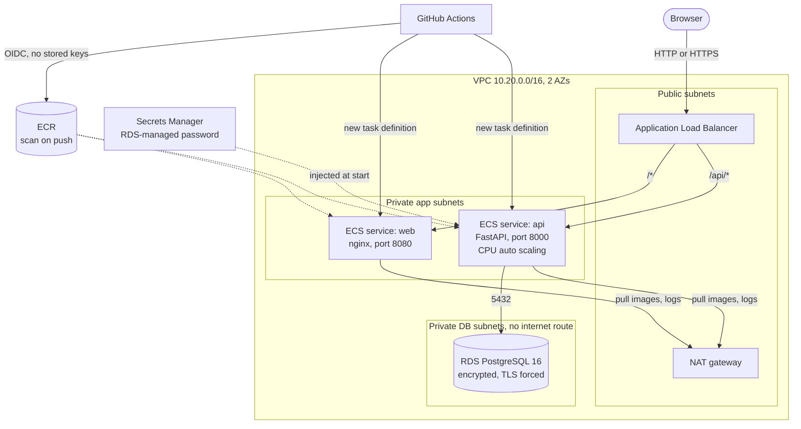
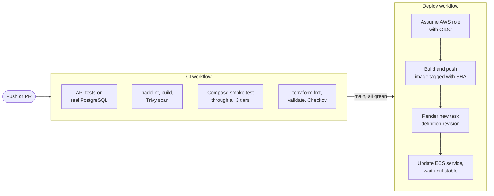
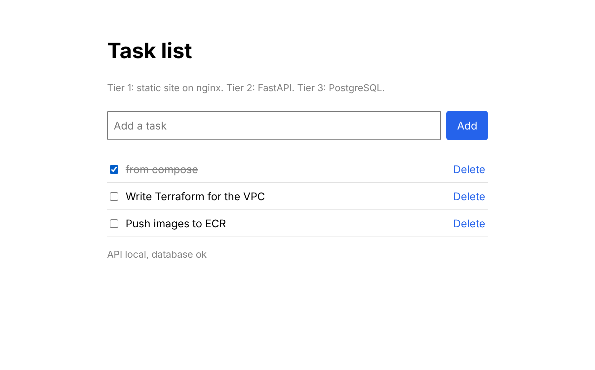

# Three-Tier Web App on AWS


A small task-list app split into three tiers, each in its own subnet layer: an nginx web tier, a FastAPI API tier and a PostgreSQL database. It runs locally with Docker Compose and on AWS with ECS Fargate, an Application Load Balancer and RDS. Terraform builds the infrastructure. GitHub Actions tests, scans and deploys it with short-lived OIDC credentials.

Built with Docker, Terraform, GitHub Actions, ECS Fargate, ALB, RDS PostgreSQL, ECR, Secrets Manager and CloudWatch.

## Architecture



Each security group allows traffic from the tier above only: internet to ALB, ALB to web and API, API to database.

### CI/CD



Deploy order is API first, then web. The ECS deployment circuit breaker rolls back a release whose tasks fail health checks.

## Demo

Local run with Docker Compose (real screenshot):



> **AWS demo video:** _placeholder. Record the app on the ALB URL, the ECS services and a GitHub Actions deploy, and add the link here before you delete the AWS resources._
>
> **AWS screenshots:** _placeholders (`docs/aws-ecs-services.png`, `docs/aws-deploy-run.png`)._

## Run it locally

Requirements: Docker with Compose v2.

```bash
docker compose up --build
```

Open <http://localhost:8080>. In Compose, nginx sends `/api/*` to the API container. On AWS the ALB does this routing.

Run the API tests (SQLite by default, PostgreSQL in CI):

```bash
cd app/api
python -m venv .venv && source .venv/bin/activate
pip install -r requirements-dev.txt
pytest --cov=app
```

## Deploy to AWS

Requirements: Terraform 1.6 or later, AWS CLI, Docker, and credentials for a test account.

1. Create the image repositories first, so the services have images to start:

   ```bash
   cd terraform
   cp terraform.tfvars.example terraform.tfvars   # set region and github_repository
   terraform init
   terraform apply -target=aws_ecr_repository.this
   ```

2. Push a first image for each tier:

   ```bash
   REGION=eu-west-2   # the same region as in terraform.tfvars
   REGISTRY=$(aws sts get-caller-identity --query Account --output text).dkr.ecr.$REGION.amazonaws.com
   aws ecr get-login-password --region "$REGION" | docker login --username AWS --password-stdin "$REGISTRY"
   for s in web api; do
     # Fargate tasks run on x86_64. --platform is needed on Apple silicon.
     docker build --platform linux/amd64 -t "$REGISTRY/three-tier/$s:bootstrap" "../app/$s"
     docker push "$REGISTRY/three-tier/$s:bootstrap"
   done
   ```

3. Create everything else:

   ```bash
   terraform apply -var image_tag=bootstrap
   terraform output app_url
   ```

4. Turn on automatic deploys. In GitHub, go to Settings, Secrets and variables, Actions, Variables, and add:

   | Variable | Value |
   | --- | --- |
   | `AWS_DEPLOY_ROLE_ARN` | `terraform output -raw github_deploy_role_arn` |
   | `AWS_REGION` | your region, for example `eu-west-2` |

   Every green CI run on `main` now deploys. Without the variable, the Deploy workflow is skipped.

For HTTPS, create an ACM certificate for your domain and set `certificate_arn`. HTTP then redirects to HTTPS (TLS 1.3 policy).

## Design decisions

- **No secrets in code or images.** RDS creates the database password and stores it in Secrets Manager (`manage_master_user_password`). ECS injects it into the API container at start-up. GitHub Actions uses OIDC, limited to the `main` branch of this repository, so there are no AWS keys in GitHub.
- **Network isolation.** Tasks have no public IP. The database subnets have no route to the internet. Security groups reference each other, not CIDR ranges.
- **Hardened containers.** Both images run as non-root users. The API container has a read-only root file system. Base images are official images (Docker Hub for Python and PostgreSQL, Amazon ECR Public for nginx-unprivileged, which is updated there first) and get OS security updates at build time. CI fails on fixable critical or high CVEs.
- **Immutable releases.** ECR tags are immutable and each image is tagged with the Git commit SHA, so a running task always maps to one commit.
- **Terraform and CI/CD do not fight.** Terraform creates the first task definition. After that, GitHub Actions owns new revisions, and the ECS services ignore `task_definition` changes in Terraform.
- **Observability.** Container logs go to CloudWatch Logs. Container Insights is on. VPC flow logs record rejected traffic. ALB access logs go to S3. RDS exports PostgreSQL logs and logs queries slower than 500 ms.
- **Cost switches.** `single_nat_gateway`, `db_multi_az` and `az_count` trade availability for cost. The defaults are for a demo.

## Limits

- Tables are created at API start-up. A production service should use migrations (for example Alembic) as a separate deploy step.
- No WAF and no custom domain by default. Add `aws_wafv2_web_acl` and a Route 53 record for production.
- Terraform state is local. For a team, use the S3 backend that is commented out in `terraform/versions.tf`.

## Cost

This stack is not free while it runs. The NAT gateway, the ALB, the RDS instance and the Fargate tasks are billed per hour, even with no traffic. Use the [AWS Pricing Calculator](https://calculator.aws/) for your region, and destroy the stack after the demo.

## Clean up

```bash
cd terraform
terraform destroy -var image_tag=bootstrap
```

ECR repositories (`force_delete`) and the ALB log bucket (`force_destroy`) are deleted with their contents. With `db_deletion_protection = false` (default), no final database snapshot is kept.

## Project layout

```text
app/web/               tier 1: static site and nginx config
app/api/               tier 2: FastAPI service and tests
docker-compose.yml     all three tiers locally
terraform/             VPC, ALB, ECS, RDS, ECR, IAM, OIDC, logs
.github/workflows/     ci.yml (test, scan, validate) and deploy.yml (ECS)
```

## Licence

MIT. See [LICENSE](LICENSE).
